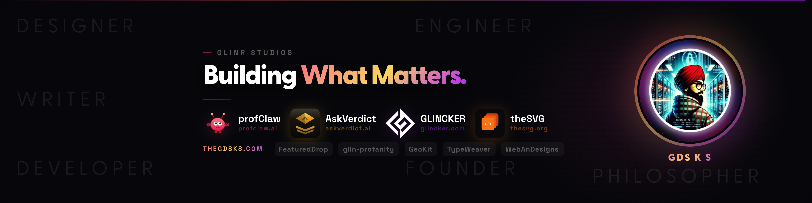

# Gagan Deep Singh

Software architect and open source creator. I build developer tools and ship products that people actually use.

**[thegdsks.com](https://thegdsks.com)** | [LinkedIn](https://www.linkedin.com/in/gdsks/) | [DEV.to](https://dev.to/thegdsks) | [npm](https://www.npmjs.com/~gdsks) | 

<!-- STATS:START -->
`3.7K+ GitHub stars` | `523.3K+ monthly npm downloads` | `97+ packages`
<!-- STATS:END -->

### Now

<!-- NOW:START -->
- Shipped **Levelrail** v0.1.0: a self-hosted deploy platform, agent-based, no SSH shelling, built-in observability.
- Shipping **theSVG** v2.1: VS Code Marketplace publish plus MCP server polish.
- Building **profClaw**: local-first AI agent engine.
- Writing weekly on [DEV.to](https://dev.to/thegdsks).
<!-- NOW:END -->

---

### What I'm building

| Project | What it is | |
|---------|-----------|---|
| [**Awesome Modern CLI**](https://github.com/thegdsks/awesome-modern-cli) | 284+ modern replacements for classic Unix tools. Curated list. |  |
| [**theSVG**](https://thesvg.org) | 6,500+ brand SVG icons. npm, CLI, API, MCP server, VS Code extension. |   |
| [**Levelrail**](https://github.com/glincker/levelrail) | Self-hosted deploy platform. Agent-based, no SSH shelling, built-in observability. |  |
| [**Stacklit**](https://github.com/glincker/stacklit) | One command gives AI agents instant codebase context. Go CLI. |  |
| [**profClaw**](https://profclaw.ai) | AI agent engine. Local-first, runs anywhere. | [profclaw.ai](https://profclaw.ai) |
| [**AskVerdict**](https://askverdict.ai) | Multi-agent AI debate engine for decision making. | [askverdict.ai](https://askverdict.ai) |
| [**BreathFlow**](https://apps.apple.com/app/id6760687887) | iOS breathing exercises app. SwiftUI. |  |
| [**GLINCKER**](https://www.glincker.com) | URL shortening, QR codes, AI content moderation. | [glincker.com](https://www.glincker.com) |

### Open source highlights

<!-- PACKAGES:START -->
| Package | What it does | Downloads/mo |
|---------|-------------|:------------:|
| [@thesvg/react](https://www.npmjs.com/package/@thesvg/react) | Typed React components for brand icons |  |
| [@thesvg/icons](https://www.npmjs.com/package/@thesvg/icons) | Tree-shakeable SVG icon components and raw SVG strings from thesvg.org - 7,600+ brand icons |  |
| [glin-profanity](https://www.npmjs.com/package/glin-profanity) | Profanity detection, 24+ languages |  |
<!-- PACKAGES:END -->

TypeScript, React, Next.js, Java, Spring Boot, Go, Rust, Swift, Python, PostgreSQL, Redis, Docker, AWS

### Latest writing

<!-- ARTICLES:START -->
- [Simple Icons alternative with full-color brand logos | theSVG](https://dev.to/thegdsks/simple-icons-alternative-with-full-color-brand-logos-4212) — Oct 15
- [Best free SVG logo library for developers in 2026](https://dev.to/thegdsks/best-free-svg-logo-library-for-developers-in-2026-171j) — Oct 15
- [theAuth Audit Trails: Compliance Logging for AI Agent Actions](https://dev.to/thegdsks/theauth-audit-trails-compliance-logging-for-ai-agent-actions-135k) — Oct 10
- [Secure an MCP Server for Production with theAuth](https://dev.to/thegdsks/secure-an-mcp-server-for-production-with-theauth-1l2b) — Oct 10
- [theAuth Multi-Tenant SaaS Auth: Orgs, RBAC, SSO, SCIM](https://dev.to/thegdsks/theauth-multi-tenant-saas-auth-orgs-rbac-sso-scim-4oe4) — Oct 10
<!-- ARTICLES:END -->

---

### About me

