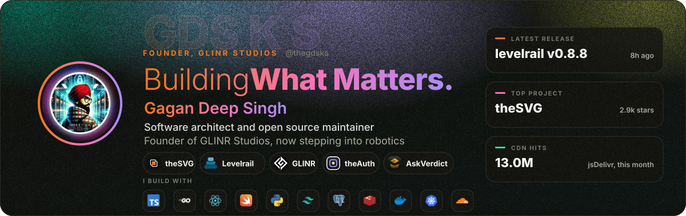
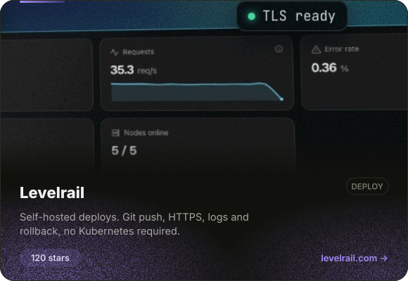
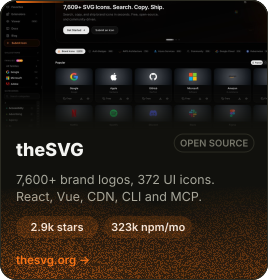
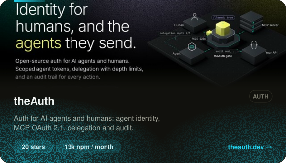
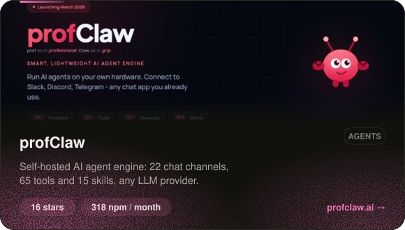
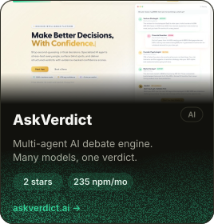
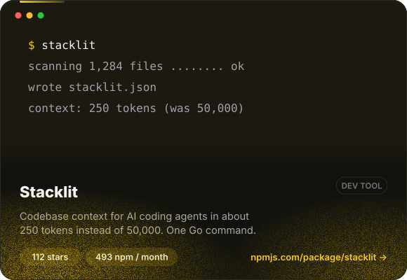

<a href="https://thegdsks.com"><picture>
  <source media="(max-width: 640px)" srcset="profile/assets/hero-mobile-dark.svg" />
  
</picture></a>

 

## By the numbers

<picture>
  <source media="(max-width: 640px)" srcset="profile/assets/stats-mobile-dark.svg" />
  
</picture>

<!-- STATS:START -->
`4K+ GitHub stars` | `436.9K+ monthly npm downloads` | `107+ packages` | `12.9M+ monthly jsDelivr hits`
<!-- STATS:END -->

  
  
  
  

## Hi, I am Gagan Deep Singh, founder of GLINR Studios

Software architect and open source maintainer, building developer infrastructure in public: deploys, auth for AI agents, icon libraries and agent engines, used by millions of developers every month. **Next up: robotics**, bringing the same small, reliable, open parts to machines that move. Also found as <a href="https://thegdsks.com"><b>@thegdsks</b></a> and <b>GDS K S</b>.

     

    

## Latest writing

<!-- WRITING:START -->
  

- [theSVG 4.0 is here, with UI icons](https://thesvg.org/blog/introducing-ui-icons) thesvg.org · Oct 26
- [Our Health Check Failed and the Deploy Went Live Anyway](https://levelrail.com/blog/health-check-passes-dead-container/) levelrail.com · Oct 24
- [Zero Downtime on One Server: What Matters](https://thegdsks.com/blog/zero-downtime-deployment-without-kubernetes) thegdsks.com · Oct 24
<!-- WRITING:END -->

From [DEV](https://dev.to/thegdsks), [theSVG](https://thesvg.org/blog), [Levelrail](https://levelrail.com/blog/) and [thegdsks.com](https://thegdsks.com/blog).

## Selected work

More: <a href="https://www.glinui.com">GlinUI</a> · <a href="https://github.com/thegdsks/awesome-modern-cli">Awesome Modern CLI</a> · <a href="https://github.com/glincker/sslx">sslx</a> · <a href="https://www.glincker.com/tools/glin-profanity">glin-profanity</a> · <a href="https://featuredrop.dev">featuredrop</a> · <a href="https://github.com/kavachos">KavachOS</a>

#### Recent releases

<!-- RELEASES:START -->

&nbsp;Oct 27&nbsp;&nbsp;&nbsp;
&nbsp;Oct 27&nbsp;&nbsp;&nbsp;
&nbsp;Oct 23&nbsp;&nbsp;&nbsp;
&nbsp;Oct 17&nbsp;&nbsp;&nbsp;
&nbsp;Oct 5&nbsp;&nbsp;&nbsp;
&nbsp;Jul 13

<!-- RELEASES:END -->

<a href="https://github.com/glincker">All repositories</a>

#### Now

<!-- NOW:START -->
- Shipping **Levelrail** v0.8.5: readiness-gated deploys, rollback and a graceful-restart fix, each covered by a tutorial run on a real install.
- Polishing **theSVG** and its MCP server.
- Building **profClaw**.
<!-- NOW:END -->

## Stack

&nbsp;&nbsp;<picture><source media="(prefers-color-scheme: dark)" srcset="https://cdn.jsdelivr.net/gh/glincker/thesvg@main/public/icons/go/dark.svg" /></picture>&nbsp;&nbsp;&nbsp;&nbsp;<picture><source media="(prefers-color-scheme: dark)" srcset="https://cdn.jsdelivr.net/gh/glincker/thesvg@main/public/icons/rust/dark.svg" /></picture>&nbsp;&nbsp;&nbsp;&nbsp;&nbsp;&nbsp;&nbsp;&nbsp;&nbsp;&nbsp;&nbsp;&nbsp;&nbsp;&nbsp;&nbsp;&nbsp;&nbsp;&nbsp;&nbsp;&nbsp;&nbsp;&nbsp;

TypeScript, Go, Rust, Java and Spring Boot, React and Next.js, Swift, Python. PostgreSQL, Redis, Docker, Kubernetes, AWS and Cloudflare. The logos are served from <a href="https://thesvg.org">theSVG</a>, the library I maintain.

## Activity

 

The banner, tiles and numbers above are generated daily from live GitHub, npm and jsDelivr data by <code>profile/generate.mjs</code>, with a dark look on every theme and a one-column layout on phones.

