

<a href="https://thegdsks.com"><picture><source media="(max-width: 640px)" srcset="profile/studio/out/hero-mobile.svg" /></picture></a> 
<picture><source media="(max-width: 640px)" srcset="profile/studio/out/numbers-mobile.svg" /></picture> 
<picture><source media="(max-width: 640px)" srcset="profile/studio/out/graph-mobile.svg" /></picture> 

<a href="https://thegdsks.com"><picture><source media="(prefers-color-scheme: dark)" srcset="profile/paper/out/link-site-ink.svg" /></picture></a> &nbsp; <a href="https://levelrail.com/blog/"><picture><source media="(prefers-color-scheme: dark)" srcset="profile/paper/out/link-levelrail-ink.svg" /></picture></a> &nbsp; <a href="https://dev.to/thegdsks"><picture><source media="(prefers-color-scheme: dark)" srcset="profile/paper/out/link-dev-ink.svg" /></picture></a> &nbsp; <a href="https://www.linkedin.com/in/gdsks/"><picture><source media="(prefers-color-scheme: dark)" srcset="profile/paper/out/link-linkedin-ink.svg" /></picture></a> &nbsp; <a href="https://www.npmjs.com/~gdsks"><picture><source media="(prefers-color-scheme: dark)" srcset="profile/paper/out/link-npm-ink.svg" /></picture></a> &nbsp; <a href="https://discord.gg/Ar5pcaZB99"><picture><source media="(prefers-color-scheme: dark)" srcset="profile/paper/out/link-discord-ink.svg" /></picture></a>

<!-- RELEASES:START -->

<a href="https://github.com/glincker/levelrail/releases/tag/v1.5.6"></a><a href="https://github.com/glincker/thesvg/releases/tag/thesvg%404.0.13"></a><a href="https://github.com/glincker/glin-profanity/releases/tag/v4.1.0"></a><a href="https://github.com/glincker/theauth/releases/tag/v1.2.0"></a><a href="https://github.com/profclaw/profclaw/releases/tag/v2.4.0"></a>

<!-- RELEASES:END -->

<!-- WRITING:START -->

<a href="https://dev.to/thegdsks/self-hosted-paas-compared-six-tools-one-fair-table-2026-2b6h"></a><a href="https://thesvg.org/blog/country-flags"></a>

<!-- WRITING:END -->

<!-- NOW:START -->
- Shipping **Levelrail v1.5.6** (Nov 18), the latest release.
- Also out: **theSVG v4.0.13** (Nov 18), **stacklit v0.5.0** (Nov 8).
- Next up: robotics, bringing the same small, reliable, open parts to machines that move.
<!-- NOW:END -->


&nbsp;&nbsp;<picture><source media="(prefers-color-scheme: dark)" srcset="https://cdn.jsdelivr.net/gh/glincker/thesvg@main/public/icons/go/dark.svg" /></picture>&nbsp;&nbsp;&nbsp;&nbsp;<picture><source media="(prefers-color-scheme: dark)" srcset="https://cdn.jsdelivr.net/gh/glincker/thesvg@main/public/icons/rust/dark.svg" /></picture>&nbsp;&nbsp;&nbsp;&nbsp;&nbsp;&nbsp;&nbsp;&nbsp;&nbsp;&nbsp;&nbsp;&nbsp;&nbsp;&nbsp;&nbsp;&nbsp;&nbsp;&nbsp;&nbsp;&nbsp;&nbsp;&nbsp;


