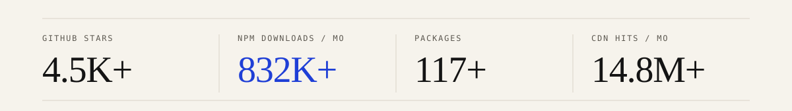
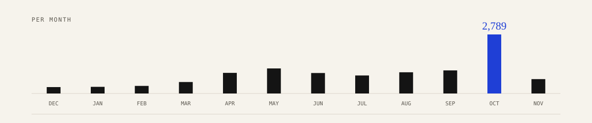
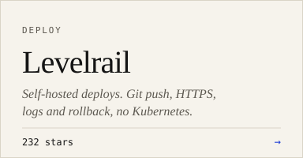

<picture>
  <source media="(prefers-color-scheme: dark) and (max-width: 640px)" srcset="profile/paper/out/hero-mobile-ink.svg" />
  <source media="(max-width: 640px)" srcset="profile/paper/out/hero-mobile-paper.svg" />
  <source media="(prefers-color-scheme: dark)" srcset="profile/paper/out/hero-ink.svg" />
  
</picture>

<a href="https://thegdsks.com">thegdsks.com</a> · <a href="https://levelrail.com/blog/">Levelrail blog</a> · <a href="https://dev.to/thegdsks">DEV</a> · <a href="https://www.linkedin.com/in/gdsks/">LinkedIn</a> · <a href="https://www.npmjs.com/~gdsks">npm</a> · <a href="https://discord.gg/Ar5pcaZB99">Discord</a>

<picture>
  <source media="(prefers-color-scheme: dark) and (max-width: 640px)" srcset="profile/paper/out/stats-mobile-ink.svg" />
  <source media="(max-width: 640px)" srcset="profile/paper/out/stats-mobile-paper.svg" />
  <source media="(prefers-color-scheme: dark)" srcset="profile/paper/out/stats-ink.svg" />
  
</picture>

<picture>
  <source media="(prefers-color-scheme: dark) and (max-width: 640px)" srcset="profile/paper/out/graph-mobile-ink.svg" />
  <source media="(max-width: 640px)" srcset="profile/paper/out/graph-mobile-paper.svg" />
  <source media="(prefers-color-scheme: dark)" srcset="profile/paper/out/graph-ink.svg" />
  
</picture>

<picture>
  <source media="(prefers-color-scheme: dark) and (max-width: 640px)" srcset="profile/paper/out/months-mobile-ink.svg" />
  <source media="(max-width: 640px)" srcset="profile/paper/out/months-mobile-paper.svg" />
  <source media="(prefers-color-scheme: dark)" srcset="profile/paper/out/months-ink.svg" />
  
</picture>

## Selected work

<a href="https://levelrail.com"><picture><source media="(prefers-color-scheme: dark)" srcset="profile/paper/out/card-levelrail-ink.svg" /></picture></a>
<a href="https://thesvg.org"><picture><source media="(prefers-color-scheme: dark)" srcset="profile/paper/out/card-thesvg-ink.svg" /></picture></a>
<a href="https://theauth.dev"><picture><source media="(prefers-color-scheme: dark)" srcset="profile/paper/out/card-theauth-ink.svg" /></picture></a>
<a href="https://profclaw.ai"><picture><source media="(prefers-color-scheme: dark)" srcset="profile/paper/out/card-profclaw-ink.svg" /></picture></a>
<a href="https://askverdict.ai"><picture><source media="(prefers-color-scheme: dark)" srcset="profile/paper/out/card-askverdict-ink.svg" /></picture></a>
<a href="https://github.com/glincker/stacklit"><picture><source media="(prefers-color-scheme: dark)" srcset="profile/paper/out/card-stacklit-ink.svg" /></picture></a>

More: <a href="https://www.glinui.com">GlinUI</a> · <a href="https://github.com/thegdsks/awesome-modern-cli">Awesome Modern CLI</a> · <a href="https://github.com/glincker/sslx">sslx</a> · <a href="https://www.glincker.com/tools/glin-profanity">glin-profanity</a> · <a href="https://featuredrop.dev">featuredrop</a> · <a href="https://github.com/kavachos">KavachOS</a> · <a href="https://github.com/glincker">all repositories</a>

## Latest writing

<!-- WRITING:START -->
- [Self-hosted PaaS compared: six tools, one fair table (2026)](https://dev.to/thegdsks/self-hosted-paas-compared-six-tools-one-fair-table-2026-2b6h) dev.to · Nov 18
- [Calif Says AI Found Java4Shell (CVE-2026-114938) in an Hour for Under $200](https://thegdsks.com/writing/calif-says-ai-found-java4shell-in-an-hour-for-under-200-ghh) thegdsks.com · Nov 18
- [Country flags in thesvg: 263 flags, three variants, one package](https://thesvg.org/blog/country-flags) thesvg.org · Nov 12
<!-- WRITING:END -->

## Now

<!-- NOW:START -->
- Shipping **Levelrail** v0.8.5: readiness-gated deploys, rollback and a graceful-restart fix, each covered by a tutorial run on a real install.
- Polishing **theSVG** and its MCP server.
- Building **profClaw**.
<!-- NOW:END -->

Cards are drawn daily by <code>profile/paper/generate.mjs</code> from live GitHub, npm and jsDelivr data.

