<a href="https://thegdsks.com"><picture><source media="(max-width: 640px)" srcset="profile/studio/out/hero-mobile.svg" /></picture></a> 
<picture><source media="(max-width: 640px)" srcset="profile/studio/out/numbers-mobile.svg" /></picture> 
<picture><source media="(max-width: 640px)" srcset="profile/studio/out/graph-mobile.svg" /></picture> 

     

<!-- RELEASES:START -->

<!-- RELEASES:END -->

<!-- WRITING:START -->

<!-- WRITING:END -->

                                 

Hover for names. Logos from <a href="https://thesvg.org">theSVG</a>.

Plain-text summary for search engines, screen readers and AI tools

### Gagan Deep Singh (thegdsks), founder of GLINR Studios

Software architect and open source maintainer building developer infrastructure in public, used by millions of developers every month. Next up: robotics. Also found as [@thegdsks](https://thegdsks.com) and GDS K S. Tagline: Building What Matters.

**Numbers, refreshed daily:** <!-- STATS:START -->
`4.5K+ GitHub stars` | `842.5K+ monthly npm downloads` | `117+ packages` | `14.7M+ monthly jsDelivr hits`
<!-- STATS:END -->

**Products**

- [Levelrail](https://levelrail.com): self-hosted deploys with git push, HTTPS, logs and rollback, no Kubernetes.
- [theSVG](https://thesvg.org): the open SVG brand library, 7,600+ brand logos and 372 UI icons for React, Vue, CDN, CLI and MCP.
- [theAuth](https://theauth.dev): auth for AI agents and humans, with agent identity, MCP OAuth 2.1, delegation and audit.
- [profClaw](https://profclaw.ai): a self-hosted AI agent engine with 22 channels, 65 tools and any LLM provider.
- [AskVerdict](https://askverdict.ai): a multi-agent AI debate engine, many models and one verdict.
- [Stacklit](https://github.com/glincker/stacklit): codebase context for AI agents in about 250 tokens instead of 50,000.

**Elsewhere:** [thegdsks.com](https://thegdsks.com), [Levelrail blog](https://levelrail.com/blog/), [DEV](https://dev.to/thegdsks), [LinkedIn](https://www.linkedin.com/in/gdsks/), [npm](https://www.npmjs.com/~gdsks), [Discord](https://discord.gg/Ar5pcaZB99), [all repositories](https://github.com/glincker).

**Stack:** TypeScript, JavaScript, Go, Rust, Swift, Python, Java, Kotlin, React, Next.js, Node.js, Tailwind CSS, Spring Boot, Vue, Svelte, PostgreSQL, Redis, Neon, MongoDB, Docker, Kubernetes, AWS, Cloudflare, Vercel, Linux, NGINX, Terraform, Git, GitHub, Figma, VS Code, Claude Code, GraphQL, Stripe.

