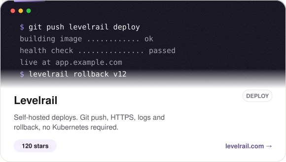
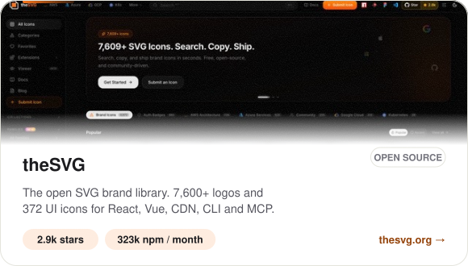
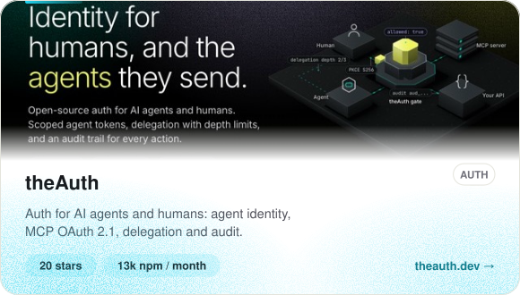
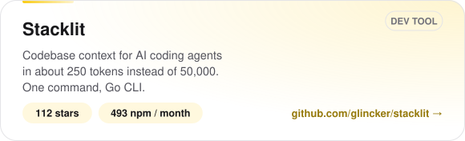
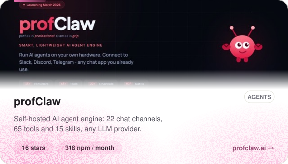
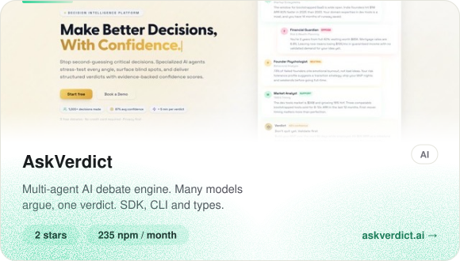
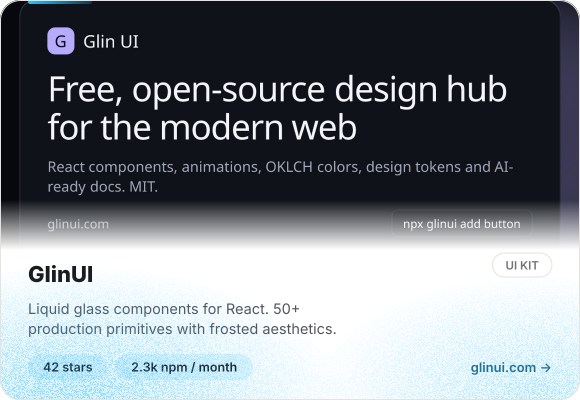
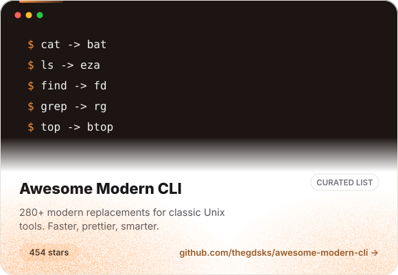
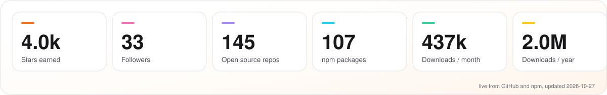

<picture>
  <source media="(prefers-color-scheme: dark)" srcset="profile/assets/hero-dark.svg" />
  
</picture>

 

## Hi, I build developer infrastructure in the open

I build developer infrastructure and ship it in public: deploy platforms, auth for AI agents, and tools that cut the boring parts of shipping software. I write hands-on engineering guides where every command was run on a real build, and I am interested in system architecture, cloud scale, reliability and agent infrastructure.

<table>
<tr>
<td width="50%" valign="top">

**Building now**

- **Levelrail**: a self-hosted deploy platform, one Go binary, no Kubernetes
- **theSVG**: 7,600+ brand logos and 372 UI icons, as packages, CLI and MCP
- **theAuth**: identity and delegation for AI agents
- **profClaw** and **AskVerdict**: agents that act, models that debate

</td>
<td width="50%" valign="top">

**Ask me about**

- Self-hosted deploys, Docker and rollbacks
- Icon systems and design tooling
- Auth, OAuth 2.1 and MCP
- Shipping open source at a steady pace

</td>
</tr>
</table>

## Selected work

<table>
<tr>
<td>
<a href="https://levelrail.com"><picture><source media="(prefers-color-scheme: dark)" srcset="profile/assets/card-levelrail-dark.svg" /></picture></a>
</td>
<td>
<a href="https://thesvg.org"><picture><source media="(prefers-color-scheme: dark)" srcset="profile/assets/card-thesvg-dark.svg" /></picture></a>
</td>
</tr>
<tr>
<td>
<a href="https://theauth.dev"><picture><source media="(prefers-color-scheme: dark)" srcset="profile/assets/card-theauth-dark.svg" /></picture></a>
</td>
<td>
<a href="https://github.com/glincker/stacklit"><picture><source media="(prefers-color-scheme: dark)" srcset="profile/assets/card-stacklit-dark.svg" /></picture></a>
</td>
</tr>
<tr>
<td>
<a href="https://profclaw.ai"><picture><source media="(prefers-color-scheme: dark)" srcset="profile/assets/card-profclaw-dark.svg" /></picture></a>
</td>
<td>
<a href="https://askverdict.ai"><picture><source media="(prefers-color-scheme: dark)" srcset="profile/assets/card-askverdict-dark.svg" /></picture></a>
</td>
</tr>
<tr>
<td>
<a href="https://www.glinui.com"><picture><source media="(prefers-color-scheme: dark)" srcset="profile/assets/card-glinui-dark.svg" /></picture></a>
</td>
<td>
<a href="https://github.com/thegdsks/awesome-modern-cli"><picture><source media="(prefers-color-scheme: dark)" srcset="profile/assets/card-modern-cli-dark.svg" /></picture></a>
</td>
</tr>
</table>

## By the numbers

<picture>
  <source media="(prefers-color-scheme: dark)" srcset="profile/assets/stats-dark.svg" />
  
</picture>

<!-- STATS:START -->
`4K+ GitHub stars` | `213.5K+ monthly npm downloads` | `107+ packages`
<!-- STATS:END -->

  
  
  
  

<table><tr><td valign="top" width="50%">

#### Latest writing

<!-- WRITING:START -->
- [Our Health Check Failed and the Deploy Went Live Anyway](https://levelrail.com/blog/health-check-passes-dead-container/) (Oct 24)
- [Roll Back a Failed Docker Deploy Without Downtime](https://levelrail.com/blog/rollback-failed-deploy-docker/) (Oct 24)
- [Install a Self-Hosted PaaS on Your Own Server in Five Minutes](https://levelrail.com/blog/install-levelrail-five-minutes/) (Oct 24)
- [Restart a Docker Container Without Downtime](https://levelrail.com/blog/restart-docker-app-without-downtime/) (Oct 24)
- [Update the PHP Docker Image Security Patch, No Downtime](https://levelrail.com/blog/ship-php-security-update-docker-zero-downtime/) (Oct 24)
- [Docker Container Restarting in a Loop: 5 Causes, Fixed](https://levelrail.com/blog/docker-container-restarting-in-a-loop/) (Oct 24)
<!-- WRITING:END -->

[All posts](https://levelrail.com/blog/)

</td><td valign="top" width="50%">

#### Recent releases

<!-- RELEASES:START -->
- [levelrail v0.8.6](https://github.com/glincker/levelrail/releases/tag/v0.8.6) (Oct 27)
- [thesvg 0.8.0](https://github.com/glincker/thesvg/releases/tag/%40thesvg/cli%400.8.0) (Oct 27)
- [thesvg 4.0.0](https://github.com/glincker/thesvg/releases/tag/thesvg%404.0.0) (Oct 27)
- [levelrail kit/v0.8.1](https://github.com/glincker/levelrail/releases/tag/kit/v0.8.1) (Oct 26)
- [levelrail v0.8.5](https://github.com/glincker/levelrail/releases/tag/v0.8.5) (Oct 26)
- [thesvg 3.4.2](https://github.com/glincker/thesvg/releases/tag/thesvg%403.4.2) (Oct 25)
<!-- RELEASES:END -->

[All repositories](https://github.com/glincker)

</td></tr></table>

### Now

<!-- NOW:START -->
- Shipping **Levelrail** v0.8.5: readiness-gated deploys, rollback and a graceful-restart fix, each covered by a tutorial run on a real install.
- Polishing **theSVG** and its MCP server.
- Building **profClaw**.
<!-- NOW:END -->

## Stack

  &nbsp;&nbsp;
  &nbsp;&nbsp;
  &nbsp;&nbsp;
  &nbsp;&nbsp;
  &nbsp;&nbsp;
  &nbsp;&nbsp;
  &nbsp;&nbsp;
  &nbsp;&nbsp;
  &nbsp;&nbsp;
  &nbsp;&nbsp;
  

TypeScript, Go, Java and Spring Boot, React and Next.js, Swift, Rust, Python. PostgreSQL, Redis, Docker, AWS. Logos are served from <a href="https://thesvg.org">theSVG</a>, the library I maintain.

## Activity

 

The banner, cards and numbers above are generated daily from live GitHub and npm data by <code>profile/generate.mjs</code>.

