 
 

<a href="https://thegdsks.com"><picture><source media="(prefers-color-scheme: dark)" srcset="profile/paper/out/link-site-ink.svg" /></picture></a> &nbsp; <a href="https://levelrail.com/blog/"><picture><source media="(prefers-color-scheme: dark)" srcset="profile/paper/out/link-levelrail-ink.svg" /></picture></a> &nbsp; <a href="https://dev.to/thegdsks"><picture><source media="(prefers-color-scheme: dark)" srcset="profile/paper/out/link-dev-ink.svg" /></picture></a> &nbsp; <a href="https://www.linkedin.com/in/gdsks/"><picture><source media="(prefers-color-scheme: dark)" srcset="profile/paper/out/link-linkedin-ink.svg" /></picture></a> &nbsp; <a href="https://www.npmjs.com/~gdsks"><picture><source media="(prefers-color-scheme: dark)" srcset="profile/paper/out/link-npm-ink.svg" /></picture></a> &nbsp; <a href="https://discord.gg/Ar5pcaZB99"><picture><source media="(prefers-color-scheme: dark)" srcset="profile/paper/out/link-discord-ink.svg" /></picture></a>

<b>Latest writing</b>

<!-- WRITING:START -->
  

- [Self-hosted PaaS compared: six tools, one fair table (2026)](https://dev.to/thegdsks/self-hosted-paas-compared-six-tools-one-fair-table-2026-2b6h) dev.to · Nov 18
- [Calif Says AI Found Java4Shell (CVE-2026-114938) in an Hour for Under $200](https://thegdsks.com/writing/calif-says-ai-found-java4shell-in-an-hour-for-under-200-ghh) thegdsks.com · Nov 18
- [Country flags in thesvg: 263 flags, three variants, one package](https://thesvg.org/blog/country-flags) thesvg.org · Nov 12
<!-- WRITING:END -->

<b>Recent releases</b>

<!-- RELEASES:START -->
- [Levelrail v1.5.6](https://github.com/glincker/levelrail/releases/tag/v1.5.6) Nov 18
- [theSVG v4.0.13](https://github.com/glincker/thesvg/releases/tag/thesvg%404.0.13) Nov 18
- [stacklit v0.5.0](https://github.com/glincker/stacklit/releases/tag/v0.5.0) Nov 8
- [glin-profanity v4.1.0](https://github.com/glincker/glin-profanity/releases/tag/v4.1.0) Oct 23
- [theAuth v1.2.0](https://github.com/glincker/theauth/releases/tag/v1.2.0) Oct 17
- [profClaw v2.4.0](https://github.com/profclaw/profclaw/releases/tag/v2.4.0) Oct 5
<!-- RELEASES:END -->

<b>Now</b>

<!-- NOW:START -->
- Shipping **Levelrail** v0.8.5: readiness-gated deploys, rollback and a graceful-restart fix, each covered by a tutorial run on a real install.
- Polishing **theSVG** and its MCP server.
- Building **profClaw**.
<!-- NOW:END -->

<b>Stack</b>

&nbsp;&nbsp;<picture><source media="(prefers-color-scheme: dark)" srcset="https://cdn.jsdelivr.net/gh/glincker/thesvg@main/public/icons/go/dark.svg" /></picture>&nbsp;&nbsp;&nbsp;&nbsp;<picture><source media="(prefers-color-scheme: dark)" srcset="https://cdn.jsdelivr.net/gh/glincker/thesvg@main/public/icons/rust/dark.svg" /></picture>&nbsp;&nbsp;&nbsp;&nbsp;&nbsp;&nbsp;&nbsp;&nbsp;&nbsp;&nbsp;&nbsp;&nbsp;&nbsp;&nbsp;&nbsp;&nbsp;&nbsp;&nbsp;&nbsp;&nbsp;&nbsp;&nbsp;

Cards are drawn daily by <code>profile/paper/generate.mjs</code> from live GitHub, npm and jsDelivr data.

